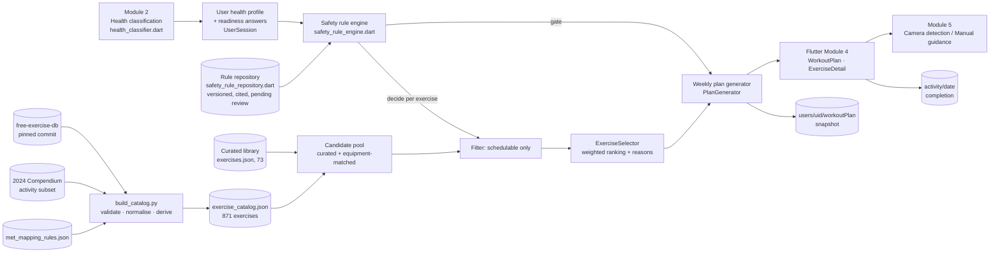

# Module 4 — Knowledge-based personalised workout generation

Report Module 4 (Workout & Exercise), FR-1 … FR-6. This extends the team's existing plan generator
(`lib/services/plan_generator.dart` + `lib/services/exercise_selector.dart`) with a two-part knowledge base, a
versioned safety-rule repository, pre-exercise screening and stored plan snapshots. Nothing in it is medical clearance.

## Architecture



Order of decisions: **screening gate → safety filter → ranking → scheduling.** A ranking score can never bring back an
exercise the rules excluded, because ranking only sees exercises the rules marked schedulable.

## 1. Dataset (free-exercise-db)

- Source: <https://github.com/yuhonas/free-exercise-db>, **Unlicense (public domain)**, pinned to commit
  `f00c92c7dcf1216a928a52c3706c7ce8e2f71ed5` (27 Sep 2026).
- Import: `python ml/exercise_catalog/build_catalog.py` (from `app/`). Downloads `dist/exercises.json` and the repository
  file list once into `ml/exercise_catalog/cache/` (git-ignored), then writes `assets/data/exercise_catalog.json`.
  Re-running produces identical output; `--check` fails if the committed catalogue is out of date.
- Result: **876 records, 871 imported**, 5 dropped (no instructions: Iron_Cross, One-Arm_Kettlebell_Swings, Push_Press,
  Side_Bridge, Side_Jackknife). 0 invalid image paths (each checked against the repository file list); 868 exercises
  have photos (3 records list none). Duplicate ids are rejected.
- Each entry keeps the dataset's fields **unchanged** under `dataset` (id, name, force, level, mechanic, equipment,
  primaryMuscles, secondaryMuscles, instructions, category, images). Missing `force`/`mechanic` stay null.
- **Derived** fields are separate (`derived`, each with a `provenance` note, `reviewStatus: pending`): group, impact
  (plyometrics → high; running/jumping cardio → high; machine/walking cardio → low; strength/stretching → low; other cardio →
  unknown), tags (plyo, isometric = dataset `force: static`, maximal = lifting-sport categories, externalLoad), joints
  (from primary muscles + mechanic + force + impact; wrist from forearm muscles or a hand-supported name such as push-up,
  dip, plank), levelNumber, complexity, equipmentKey, timed.
- Photos are loaded on demand from the repository at the pinned commit (not bundled, not re-downloaded by the app).
- The 73-exercise curated library stays the primary body-weight set. 55 catalogue entries are linked to curated
  exercises (`curatedAs`) and are not offered twice; curated exercises that are an **exact** dataset match show its photos.

## 2. MET values (2024 Adult Compendium)

- Reference: Herrmann SD, Willis EA, Ainsworth BE, et al. *2024 Adult Compendium of Physical Activities.* J Sport Health
  Sci 2024;13(1):6–12. Terms (pacompendium.com): free to use with citation; MET values must not be changed. The full
  spreadsheet is available only by email request, so the **27 activities used** were copied verbatim from the public
  category pages into `ml/exercise_catalog/compendium_2024_subset.json` (code, MET, description, URL, retrieval date).
  A test checks every assigned value equals the published value for its code.
- Matching (`met_mapping_rules.json`, ordered, first match wins) uses category, equipment, force and mechanic; names are
  used only together with those, where the Compendium names the movement.
- Results: **181 exact, 606 approximate, 84 unmatched.** Approximate = broader activity class, flagged for review, never
  treated as validated. Unmatched = no MET value, not scheduled. Every mapping has `reviewStatus: pending`.
- Calories (`lib/services/met_calculator.dart`): the app uses **kcal ≈ MET × kg × active hours** everywhere. The
  oxygen form (MET × 3.5 × kg × min / 200) is 5% higher and is provided for comparison only. Rest between sets is
  excluded; figures are approximate gross expenditure.

## 3. Module 2 integration

`UserSession.setProfile` classifies the stored profile (Module 2), then `PlanGenerator.generate` builds
`HealthFacts` from fields Baymax actually stores — classification, conditions, BMI, age (or "not recorded"), weight,
height, activity level — plus the plan intensity and the readiness answers. Nothing missing is filled in: a missing
date of birth or weight asks for the information (needsInfo) when screening is on.

Readiness answers (`lib/models/workout_readiness.dart`, screen `workout_readiness_screen.dart`, stored at
`users/{uid}/workoutReadiness`): warning symptoms (topics of PAR-Q+ / ACSM screening, reworded), doctor's clearance
(yes / no / not sure), current injuries (knee, lower back, shoulder, wrist, ankle), equipment owned.

## 4. Safety rule repository

`lib/services/workout_rules/safety_rule_repository.dart` (data) + `safety_rule_engine.dart` (evaluation),
version `rules-2026.10.1`. Each rule: id, title, kind (screening / medical / injury / program), basis (guideline /
team precaution), conditions, effects, user-facing note, evidence keys, `reviewStatus` (all `pending`).

| Rules | Effect |
|---|---|
| SCR-SYMPTOMS | any warning symptom → **requires clearance**, no plan |
| SCR-CARDIAC-UNANSWERED / SCR-CARDIAC-CLEARANCE / SCR-HEART-CONDITION-LISTED | heart condition: unanswered → needs info; no clearance → requires clearance |
| SCR-MISSING-AGE / -WEIGHT / -HEIGHT | needs info |
| MED-CARDIAC, MED-HTN, MED-DIABETES, MED-ASTHMA, BODY-*, AGE-*, EXP-SEDENTARY, INT-* | the existing Module 3 restrictions, unchanged |
| INJ-KNEE / BACK / SHOULDER / WRIST / ANKLE | high impact on that joint excluded; other loading → eligible with modification |
| PRG-NO-MAXIMAL | no powerlifting / olympic / strongman, no expert-level dataset exercises (program scope, not medical) |

Outcomes per exercise: eligible · eligible with modifications · requires information · requires clearance · excluded.
Guarantees (all tested): restrictions merge to the **most restrictive** value; an exercise with **unknown** impact is
not scheduled for anyone with an impact restriction or injury; an **unapproved** rule cannot relax anything, and even an
approved one can only lift program-scope exclusions, never a medical or screening one.
`test/workout_rules_test.dart` checks the repository reproduces the original Module 3 restrictions exactly for 3,000
random people (oracle copied from commit fb98995).

## 5. Generation and ranking

1. Gate: if screening says needsInfo / needsClearance, the week is empty and `PersonalizedPlan.gate` carries the reasons.
2. Pool: curated library + (if equipment is owned) catalogue exercises that need that equipment, have a MET mapping and
   are in a programmed category (strength, cardio, plyometrics, stretching).
3. Filter: `SafetyAssessment.decide(e).schedulable`.
4. Rank: the team's `ExerciseSelector` (difficulty fit, goal, joint load by BMI/age, floor transfers, coordination,
   weekly variety, deterministic tie-break) — its weights are team design choices, not validated. Module 4 adds a 0.3
   penalty for catalogue entries (unreviewed instructions) and the reason "Uses equipment you have".
5. Schedule: goal templates and weekly day patterns (2–6 days, capped by the rules), warm-up, cool-down and targeted
   stretches; sets/reps/rest from the prescription rules by intensity (2–4 sets, ~8–11 reps, 40–60 s rest), **never
   from MET**; isometric holds capped where a rule says so.
6. Explain: each exercise carries `reasons` (ranking) and `ruleNotes` (rules that adapted it, with ids).
7. Store: a compact versioned snapshot (`users/{uid}/workoutPlan`: engine/rules/catalogue versions, classification,
   intensity, goal, gate, days, FNV-1a fingerprint) is written when it changes.

Same inputs + same rule/catalogue versions → identical plan (tested).

## 6. UI

Workout tab: classification tag, day strip, stats (duration, kcal, exercises), exercise cards with photo thumbnails and
"Adapted for you" chips, completion (`activity/{date}`, existing), readiness prompt, gate screen when blocked.
Exercise detail: looping photos (pause when the screen is hidden), metrics + kcal, MET line with match type, muscles,
difficulty/impact, "Why this exercise", "Adapted for you by the safety rules", technique with its source, a safety note
that does not claim safety, and **Start exercise** → Module 5 (camera where `ExerciseFormRules` supports the id,
manual guidance otherwise).

## 7. Commands

```bash
cd app
python ml/exercise_catalog/build_catalog.py          # re-import (idempotent)
python ml/exercise_catalog/build_catalog.py --check  # verify the committed catalogue
flutter test test/module4_test.dart test/workout_rules_test.dart
flutter test
```

## 8. Known limitations / needs review

- **No rule, MET mapping or derived field has been reviewed by a qualified professional.** Approximate METs are
  estimates; team precautions are not guideline quotations.
- Readiness questions are a reworded screening aid, not the official PAR-Q+; clearance is self-reported.
- Catalogue instructions are shown as published (unreviewed); position (standing/floor) is unknown for them.
- Photos need a network connection (GitHub raw content); offline the icon is shown.
- The catalogue is a bundled asset, not in Firestore (no extra reads). Seeding it to Firestore would need a new
  collection and rules.
- `workoutReadiness`, `workoutPlan` (and the Module 5 `workoutSessions`, `exerciseFeedback`) are in the merged
  `database.rules.json`, deployed and verified on 2026-10-17. Teammates deploying rules must start from this file.
- Next steps (classification profiles, intensity bands): [plan](MODULE4_KB_IMPLEMENTATION_PLAN.md),
  [ledger](MODULE4_PHASE_LEDGER.md).
- Future: the Gradient Boosting session-calorie model (`WorkoutCalorieModel`) already replaces the MET estimate per day
  when its file is bundled; it is not trained yet.
